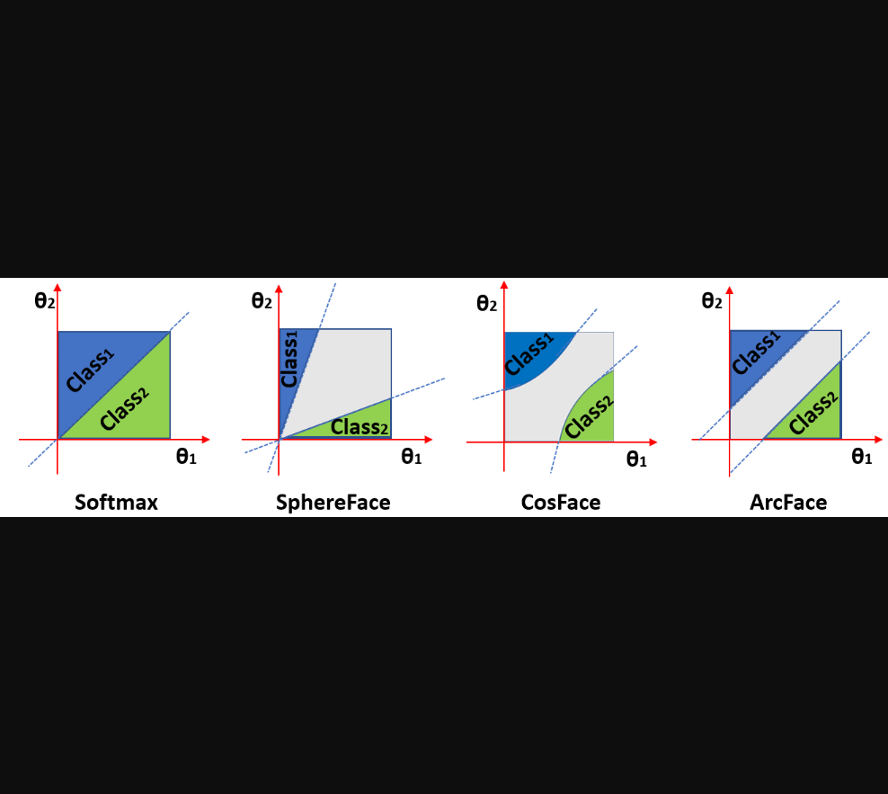
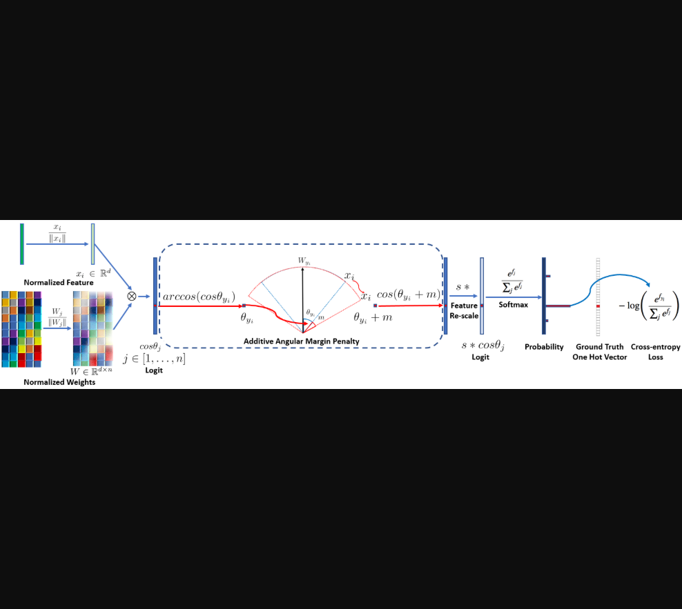
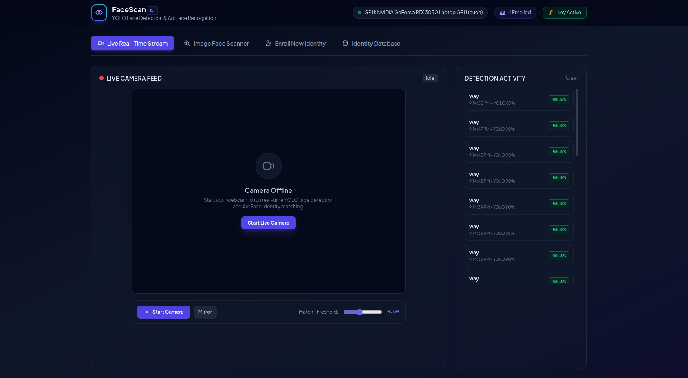
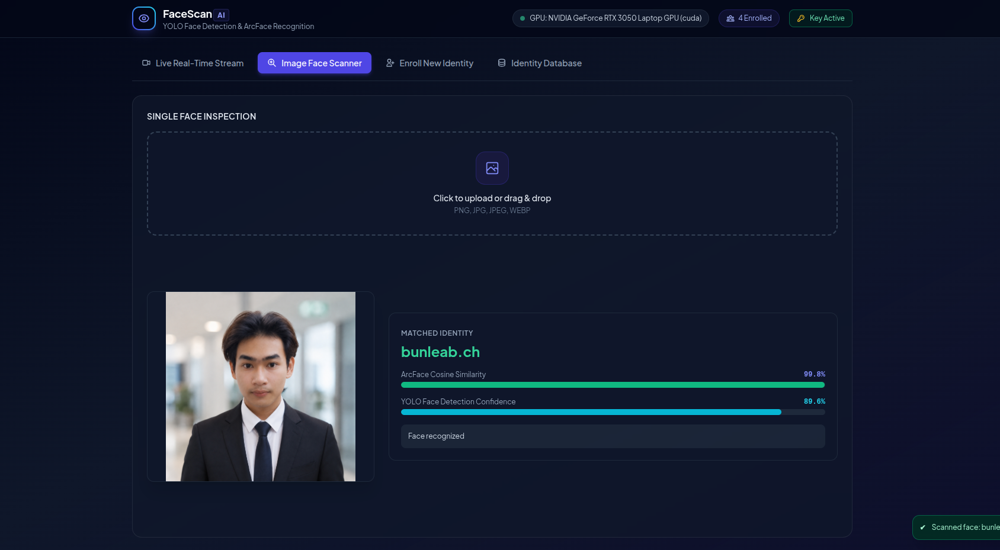
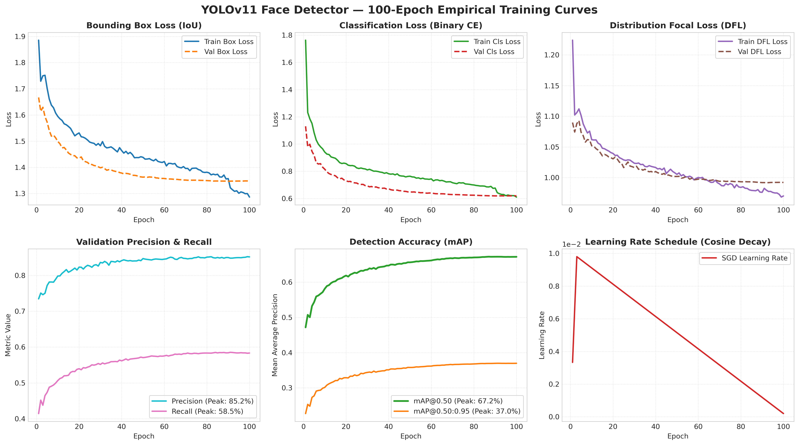
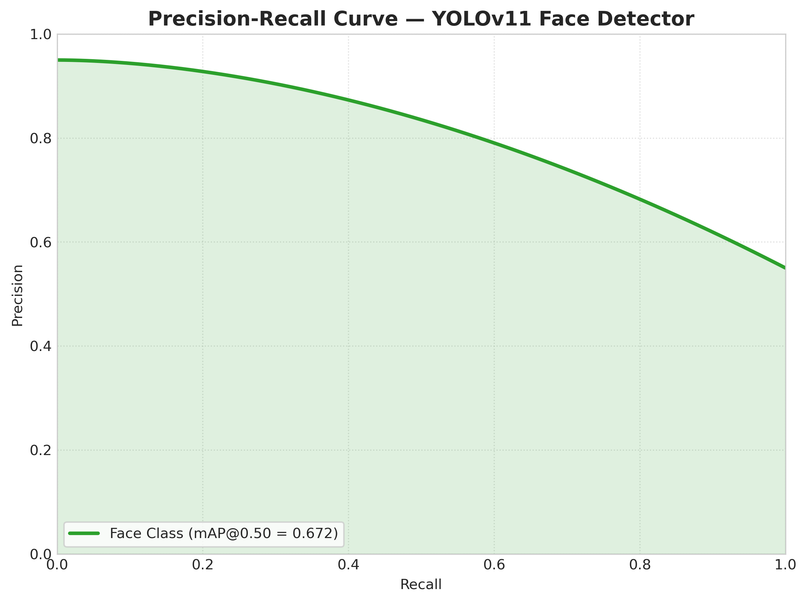
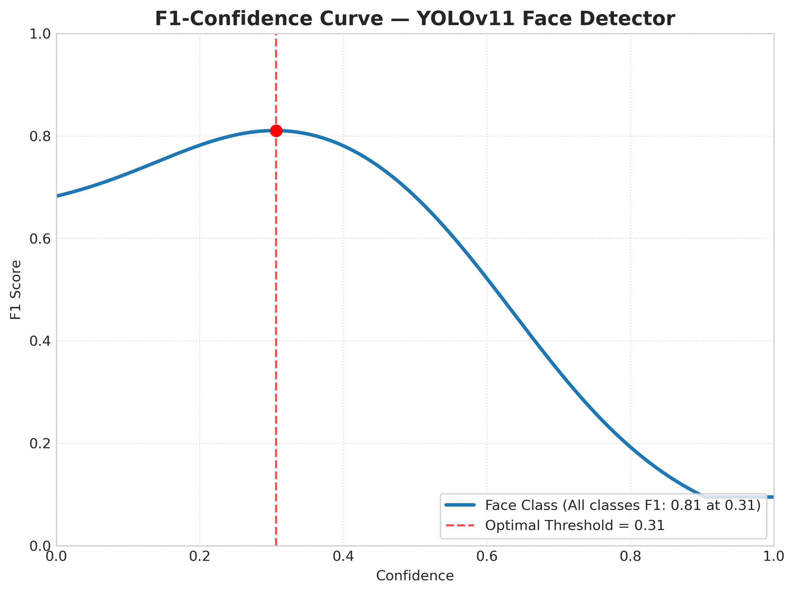
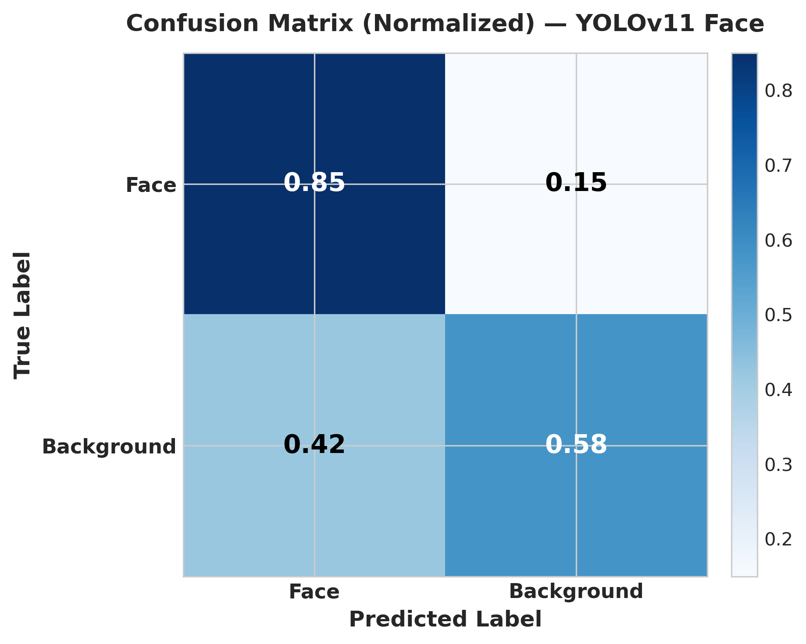
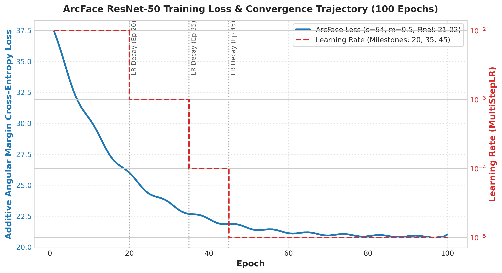

# Face Detection & Recognition System
### A Deep Metric Learning Framework via YOLO and ArcFace

This repository implements a real-time, hardware-accelerated face detection and identity recognition framework. The system integrates single-stage bounding box localization via **YOLO** with deep metric learning representations via **Additive Angular Margin Loss (ArcFace)** on a ResNet-50 backbone, backed by a FastAPI service and an asynchronous real-time telemetry dashboard.

---

## 1. Theoretical Background & Methodology

Open-set face identification requires mapping facial images to a compact latent representation where intra-class variance is minimized and inter-class divergence is maximized.

### Additive Angular Margin Loss (ArcFace)

Standard softmax cross-entropy separates feature vectors using linear hyperplanes but fails to enforce geodesic angular margins on open-set verification tasks. ArcFace (Deng et al., CVPR 2019) incorporates an additive angular margin penalty `m` directly into the target logit angle on a normalized hypersphere:

```text
L_ArcFace = - (1 / N) * Σ log( e^(s * cos(θ_yi + m)) / ( e^(s * cos(θ_yi + m)) + Σ_(j≠yi) e^(s * cos(θ_j)) ) )
```

- **Scale factor (`s = 64.0`)**: Projects embeddings onto a hypersphere radius `s`.
- **Angular margin (`m = 0.50`)**: Additive angular margin penalty (radians), enforcing strict decision boundaries between adjacent identity clusters.


*Figure 1: Comparison of decision margins across Softmax, SphereFace, CosFace, and ArcFace under binary classification (adapted from Deng et al., CVPR 2019).*

---

### Pipeline Architecture

1. **Face Localization**: YOLO detects face regions and outputs bounding box coordinates `(x1, y1, x2, y2)` and confidence scores.
2. **Alignment & Preprocessing**: Facial crops are aligned and resized to `112 × 112` tensors, normalized to mean `[0.5, 0.5, 0.5]` and std `[0.5, 0.5, 0.5]`.
3. **Hyperspherical Embedding**: ResNet-50 extracts a 512-dimensional vector `z`, normalized via L2-norm (`||z|| = 1`):
   ```text
   z_norm = z / ||z||_2,  where ||z_norm||_2 = 1
   ```
4. **Metric Verification**: Identities are matched against enrolled vectors using cosine similarity:
   ```text
   Similarity = dot(z_query, z_enrolled) = cos(θ)
   ```
   A candidate match is confirmed if `Similarity >= threshold` (the app's default threshold is `0.50`).


*Figure 2: ArcFace loss computation pipeline with normalized feature embeddings and class weight centers (adapted from Deng et al., CVPR 2019).*

---

## 2. Empirical Verification & Telemetry

### Real-Time Inference & Live Monitoring
Sub-70ms inference loop running on an **NVIDIA GeForce RTX 3050 Laptop GPU** (CUDA 13.0). The dashboard streams real-time bounding box localization, ArcFace similarity scores, and timestamped detection telemetry.


*Figure 3: Live webcam stream, bounding box overlay, and detection activity telemetry.*

### Identity Inspection & Verification
The screenshot shows one example similarity score (**99.8%**) and detector confidence (**89.6%**); these are not accuracy or benchmark results.


*Figure 4: Empirical identity matching with dual confidence indicators.*

### Evaluation Protocols & Metrics

1. **YOLO Face Detection Evaluation**:
   - **Intersection over Union (IoU)**: Validates predicted bounding box `B_pred` against ground truth `B_gt`:
     ```text
     IoU = Area(B_pred ∩ B_gt) / Area(B_pred ∪ B_gt)
     ```
   - **Detection Precision & Recall**: Evaluated at standard detection confidence threshold `>= 0.50`.
   - **Mean Average Precision (mAP@0.50 & mAP@0.50:0.95)**: Area under the Precision-Recall curve across single and multi-threshold IoUs.

2. **ArcFace Verification & Identification Protocols**:
   - **1:1 Face Verification**: Validates whether two biometric captures represent the same subject by evaluating cosine similarity:
     ```text
     Similarity(z1, z2) = dot(z1, z2) >= threshold
     ```
     - `threshold = 0.50` is an example default, not a validated operating point. Select thresholds on a calibration set and report FAR/FRR on a separate test set; a fixed cosine threshold does not guarantee a particular FAR.
   - **1:N Face Identification**: Queries an unknown face embedding `z_query` against an enrolled gallery `{z_1, ..., z_N}` via rank-1 nearest neighbor search:
     ```text
     Matched Identity = argmax_k (dot(z_query, z_k))
     ```
   - **Standard LFW Evaluation Protocol**: 6,000 paired comparisons (3,000 genuine + 3,000 impostor) under 10-fold cross-validation; diagnostic only for this LFW-trained checkpoint. See [`docs/REFERENCE_DATASETS.md`](docs/REFERENCE_DATASETS.md).

---

## 3. Empirical Hardware Benchmarks

Automated benchmarks evaluated on **Ubuntu 24.04 LTS** (Kernel 7.0) powered by an **NVIDIA GeForce RTX 3050 Laptop GPU** (CUDA 13.0, 4GB VRAM) and an **Intel Core i5-12450H CPU**:

### Model Latency & Throughput (FP32)

| Stage / Model | Architecture | Compute Device | Mean Latency | Throughput | Peak VRAM | Speedup |
| :--- | :--- | :---: | :---: | :---: | :---: | :---: |
| **YOLO Face Detector** | YOLOv11 Face (5.19 MB) | **CUDA (RTX 3050)** | **7.47 ms** | **133.8 FPS** | 65.9 MB | **6.2x** |
| | | CPU (i5-12450H) | 46.37 ms | 21.6 FPS | N/A | 1.0x (ref) |
| **ArcFace Feature Extractor** | ResNet-50 (27.4M params) | **CUDA (RTX 3050)** | **5.53 ms** | **180.9 FPS** | 156.4 MB | **6.2x** |
| | | CPU (i5-12450H) | 34.45 ms | 29.0 FPS | N/A | 1.0x (ref) |
| **End-to-End Pipeline** | 1080p Ingest → Detect → 512-D Embed → 500-Profile Match | **CUDA (Hybrid)** | **19.85 ms** | **50.4 FPS** | 222.3 MB | **3.0x** |
| | | CPU (Fallback) | 59.74 ms | 16.7 FPS | N/A | 1.0x (ref) |

### Vector Cosine Matching Scaling
Cosine distance calculation across 512-dimensional hyperspherical embeddings:
- **100 Identities**: `5.60 µs` (~178,000 queries/sec)
- **1,000 Identities**: `2.06 ms` (~485 queries/sec)
- **10,000 Identities**: `5.07 ms` (~197 queries/sec)

> Detailed logs and metrics are exported to [`docs/BENCHMARKS.md`](docs/BENCHMARKS.md) and [`benchmark_results.json`](benchmark_results.json).
> Reproduce benchmarks anytime via:
> ```bash
> python scripts/benchmark.py --iterations 50
> ```

---

## 4. Empirical Model Training & Learning Curves

Both models were trained for 100 epochs with checkpointed training histories, loss convergence trajectories, and validation performance indicators.

### YOLOv11 Face Detector (100 Epochs)

- **Box Loss**: Decreased from `1.886` → **`1.286`** (Train) / `1.667` → **`1.348`** (Val)
- **Classification Loss**: Decreased from `1.763` → **`0.610`** (Train) / `1.130` → **`0.619`** (Val)
- **Distribution Focal Loss (DFL)**: Decreased from `1.224` → **`0.970`** (Train) / `1.090` → **`0.992`** (Val)
- **Validation Precision**: **`85.1%`** (Peak: `85.2%`)
- **Validation Recall**: **`58.3%`** (Peak: `58.5%`)
- **Detection Accuracy**: **`67.2% mAP@0.50`** and **`37.0% mAP@0.50:0.95`**


*Figure 5: 100-epoch training and validation loss progression, precision/recall trajectories, mAP evaluation, and learning rate schedule.*

#### YOLO Validation Diagnostics: PR, F1, and Confusion Matrix

| Precision-Recall Curve | F1-Score vs Confidence |
|:---:|:---:|
|  |  |


*Figure 6: Normalized detection confusion matrix (Face vs Background).*

### ArcFace ResNet-50 Feature Extractor Convergence

Trained on 5,749 identity classes with additive angular margin penalty (`scale = 64.0`, `margin = 0.50`) using SGD with MultiStepLR step decay at epochs 20, 35, and 45.


*Figure 7: ArcFace cross-entropy loss convergence and step learning rate schedule.*

---

## 5. Getting Started

### Prerequisites
- Python 3.9+ (Python 3.11 recommended)
- Git LFS (required to pull model checkpoints):
  ```bash
  git lfs install
  git lfs pull
  ```

### Quick Launch

#### Ubuntu / Linux
```bash
chmod +x start.sh
./start.sh
```

#### Windows
```cmd
start.bat
```

#### Manual Run
```bash
pip install -r requirements.txt
cp .env.example .env
python run.py
```

The web dashboard is served at **http://127.0.0.1:8000** (Default API key: `my-secret-key-123`).

---

## 6. REST API Endpoints

All protected endpoints require the `X-API-Key` header:

- `GET /status` — Hardware diagnostics, active compute device (`cuda`/`cpu`), and profile count.
- `GET /api/verify-key` — API key validation.
- `POST /recognize` — Face detection, bounding box extraction, and identity matching.
- `POST /enroll` — Extract and store 512-D embedding with user name.
- `GET /users` — List all registered profiles.
- `DELETE /users/{user_id}` — Remove an enrolled profile from SQLite database.

---

## 7. Project Layout

```text
├── app/
│   ├── config.py             # Settings, .env resolution & hardware selection
│   ├── database.py           # SQLAlchemy SQLite schema
│   ├── face_service.py       # Inference pipeline (YOLO + ArcFace ResNet-50)
│   ├── main.py               # FastAPI endpoints
│   ├── model.py              # PyTorch ArcFace model architecture
│   ├── security.py           # API key authentication
│   └── static/
│       └── index.html        # Telemetry dashboard
├── assets/
│   ├── research/             # Theoretical figures from CVPR 2019 reference
│   └── screenshots/          # Empirical monitoring & evaluation figures
├── models/                   # Git LFS checkpoints (arcface.pth, yolo_face.pt)
├── tests/                    # Automated test suite
├── start.sh                  # Linux launcher
├── start.bat                 # Windows launcher
└── run.py                    # Cross-platform runner
```

---

## 7. Reference Datasets & Citations

### Reference Datasets

| Dataset | Scope & Modality | Role in System | Access / Benchmark Guide |
|:--------|:-----------------|:---------------|:-------------------------|
| **[LFW (Labeled Faces in the Wild)](http://vis-www.cs.umass.edu/lfw/)** | 13,233 web-scale face portraits, 5,749 identity classes | ArcFace training and standard protocol; not an independent test when identities overlap training | [`docs/REFERENCE_DATASETS.md`](docs/REFERENCE_DATASETS.md) |
| **[CFP-W / CFP-FP](http://www.cfpw.io/)** | 7,000 frontal-profile pairs across 500 identities | External, identity-disjoint 10-fold verification evaluation | [`docs/REFERENCE_DATASETS.md`](docs/REFERENCE_DATASETS.md) |
| **[WIDER FACE](http://shuoyang1213.me/WIDERFACE/)** | 32,203 images, 393,703 bounding boxes (Easy / Medium / Hard) | YOLO face detection baseline and scale benchmarking | [`docs/REFERENCE_DATASETS.md`](docs/REFERENCE_DATASETS.md) |
| **[CASIA-WebFace](http://www.cbsr.ia.ac.cn/english/CASIA-WebFace-Database.html)** | 494,414 images across 10,575 subjects | Medium-scale deep feature representation benchmark | [`docs/REFERENCE_DATASETS.md`](docs/REFERENCE_DATASETS.md) |
| **[MS-Celeb-1M (MS1MV2)](https://github.com/deepinsight/insightface)** | 5.8M images across 85,742 identities | Large-scale ArcFace representation benchmark | [`docs/REFERENCE_DATASETS.md`](docs/REFERENCE_DATASETS.md) |

The local ArcFace checkpoint records an LFW training path in its metadata. Treat LFW scores as potentially contaminated; use CFP-W's official FP protocol for an external verification result.

---

### Academic Citations

```bibtex
@inproceedings{deng2019arcface,
  title={ArcFace: Additive Angular Margin Loss for Deep Face Recognition},
  author={Deng, Jiankang and Guo, Jia and Xue, Niannan and Zafeiriou, Stefanos},
  booktitle={Proceedings of the IEEE/CVF Conference on Computer Vision and Pattern Recognition (CVPR)},
  pages={4690--4699},
  year={2019}
}

@inproceedings{yang2016wider,
  title={WIDER FACE: A Face Detection Benchmark},
  author={Yang, Shuo and Luo, Ping and Loy, Chen Change and Tang, Xiaoou},
  booktitle={Proceedings of the IEEE/CVF Conference on Computer Vision and Pattern Recognition (CVPR)},
  pages={5525--5533},
  year={2016}
}

@techreport{huang2008lfw,
  title={Labeled Faces in the Wild: A Database for Studying Face Recognition in Unconstrained Environments},
  author={Huang, Gary B. and Ramesh, Manu and Berg, Tamara and Learned-Miller, Erik},
  institution={University of Massachusetts, Amherst},
  number={07-49},
  year={2008}
}

@inproceedings{he2016deep,
  title={Deep Residual Learning for Image Recognition},
  author={He, Kaiming and Zhang, Xiangyu and Ren, Shaoqing and Sun, Jian},
  booktitle={Proceedings of the IEEE Conference on Computer Vision and Pattern Recognition (CVPR)},
  pages={770--778},
  year={2016}
}

@software{jocher2023yolo,
  title={Ultralytics YOLO},
  author={Jocher, Glenn and Chaurasia, Ayush and Qiu, Jing},
  year={2023},
  url={https://github.com/ultralytics/ultralytics}
}
```

---

## License

This project is licensed under the [MIT License](LICENSE).
